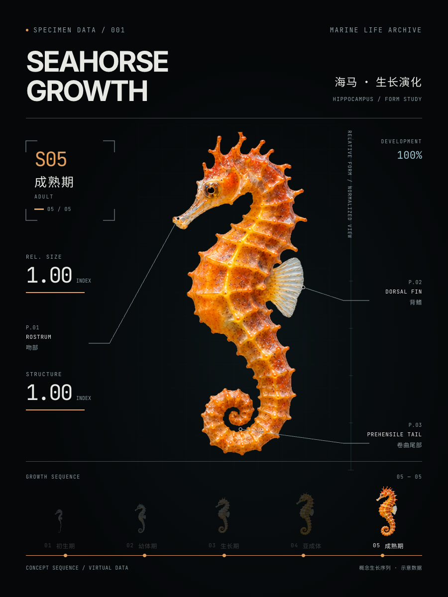

# Bio Growth Animation

A reusable Codex skill for smooth biological growth animations: specimen-style HUD, landmark-matched mesh deformation, silhouette interpolation, anatomy callouts, and MP4 export.

将本次海马制作流程封装为可替换生物的技能。默认输出 **10秒 / 900×1200 / 60fps** 的黑底科学档案风短片。

[](docs/seahorse-growth.mp4)

[观看海马示例视频](docs/seahorse-growth.mp4)

## 安装到 Codex

### 使用 npx（推荐）

```sh
npx skills add wifecooky/bio-growth-animation -a codex -g -y
```

`-a codex` 指定 Codex，`-g` 安装到用户级目录，供各项目使用，`-y` 跳过确认提示。需要可用的 Node.js 和 npx；完整参数见 [Skills CLI 文档](https://github.com/vercel-labs/skills/blob/main/docs/commands.md)。

### 手动安装

```sh
git clone https://github.com/wifecooky/bio-growth-animation.git \
  "${CODEX_HOME:-$HOME/.codex}/skills/bio-growth-animation"
```

已有同名技能时，先保留本地修改。新建会话，让 Codex 加载新增技能。

之后可以直接说：

```text
用 $bio-growth-animation 做一个海龟从幼体到成体的生长动画，
10秒、青绿色、60fps，保持科学档案风格。
```

技能会为新生物生成阶段素材、重新标定解剖控制点，并制作跟随身体变化的引线与数据。不要只替换海马标题而复用海马图像和控制点。

## 能力

- 2–8个生长关键姿态，阶段数量、时长、配色和标注可配置。
- 共享三角网格与连续样条控制身体变化，距离场插值减少叠化时的双重轮廓。
- 解剖引线、指标与时间轴跟随同一个生长进度。
- 本地图像、字体和GSAP运行库；已有素材的渲染不需要图像API凭据。
- 图集、控制点、时序与标注绑定的配置验证，以及视频检查和导出流程。

## 运行内置海马示例

需要 Python 3、Node.js 22+、FFmpeg，以及能够运行Chrome/WebGL的环境。首次执行HyperFrames CLI可能需要下载依赖。生成新生物的阶段素材需要可用的图像生成工具。

在仓库根目录运行：

```sh
python3 scripts/create_project.py \
  --config assets/examples/seahorse.json \
  --validate-only

python3 scripts/create_project.py \
  --config assets/examples/seahorse.json \
  --out work/seahorse
```

然后在 `work/seahorse` 中运行：

```sh
npm run check -- --snapshots
npm run dev
npm run render -- --quality delivery --output renders/growth.mp4
```

源项目必须包含完整的 `assets/`，不能只保留生成的HTML文件。

## 替换生物

1. 根据生物的真实或概念生长阶段制作透明图集，保持视角、朝向与光照一致。
2. 从示例配置复制结构，替换标题、阶段、图集尺寸和解剖控制点。
3. 调整对齐锚点、缩放、配色和标注位置；在新的空目录生成项目。
4. 检查相邻阶段的过渡中间帧，再导出成片。

详细工作流见 [SKILL.md](SKILL.md)、[配置说明](references/config.md)、[素材与解剖指导](references/assets-and-anatomy.md)。

内置模板采用3:4布局，其他比例需要实际调整版式。蛙、蝴蝶等明显变态发育需要按身体结构连续的区间分段设计。半透明生物需要检查alpha阈值对细边、薄翅和触手的影响。示例图像与数值为概念视觉，不是实测科研数据。

## 本地测试

```sh
python3 scripts/test_create_project.py
node scripts/test_renderer.mjs
```

已验证：7项Python生成器回归测试、2/3/7阶段渲染器行为测试、五阶段完整项目检查与10秒60fps导出，以及三阶段8秒配色变体的检查与中间帧。

## 第三方资源

GSAP及字体保留各自的许可与版权声明，详见 [THIRD_PARTY.md](assets/template/THIRD_PARTY.md) 和 [字体OFL许可证](assets/template/fonts/OFL.txt)。示例海马素材为本项目使用图像生成工具制作。
